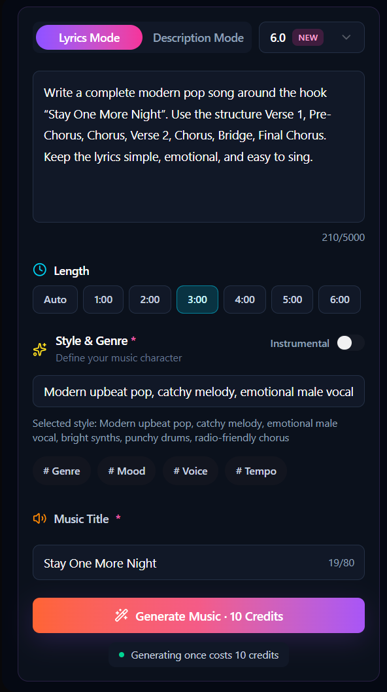
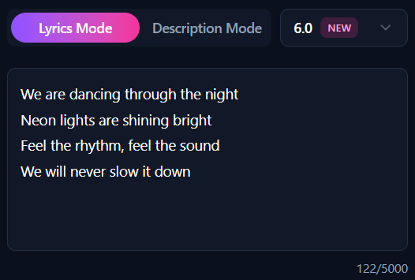
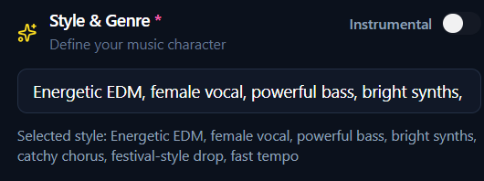
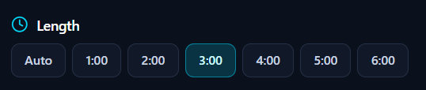
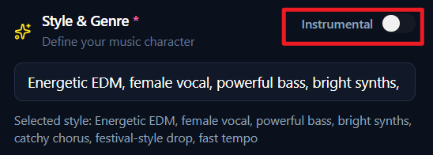
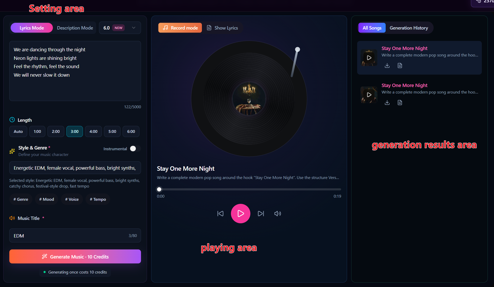

[show all articles](../README.md)

# How to Make EDM Music: A Step-by-Step Guide for Beginners

If you want to create an EDM song, you do not have to start by learning complex music production software. With an AI music generator, you can make a complete electronic dance track using lyrics, style descriptions, and a few simple settings.

Below, we will use Songnexa as an example and show you how to create an EDM song step by step.

## Step 1: Open the Music Generator

First, open the Songnexa AI Music Generator page.

You will see the song generation section. The main settings you need to use are:

- Lyrics
- Style of Music
- Title
- Instrumental
- Generate

## Step 2: Enter the Lyrics

Find the **Lyrics** field and enter the words you want the song to sing.

The lyrics can be simple.

You can use this example directly:

> We are dancing through the night
> Neon lights are shining bright
> Feel the rhythm, feel the sound
> We will never slow it down

EDM lyrics are often quite simple. The key is to keep the chorus easy to repeat and easy to remember. For a quick test, around 4–8 lines is enough.

## Step 3: Set the EDM Music Style

Next, locate **Style of Music**.

This setting is very important because it controls how the generated song will sound.

Instead of entering only “EDM,” describe the style in more detail.

You can use:

> Energetic EDM, female vocal, powerful bass, bright synths, catchy chorus, festival-style drop, fast tempo

If you want a more club-focused sound, try:

> Club EDM, deep bass, strong kick drums, energetic synths, catchy vocal hook, powerful drop

If you prefer a lighter electronic pop sound, use:

> EDM pop, upbeat, bright synths, female vocal, catchy melody, clean electronic drums

## Set the Duration

Choose the song duration based on what you need.

## Step 4: Enter the Song Title

Type a song name into the **Title** field.

For example:

Neon Night

or

Dancing in the Lights

The title does not directly affect the sound of the music, so just choose a name that fits the theme of the lyrics.

## Step 5: Choose Whether You Want Vocals

If you want a complete EDM song with vocals, leave **Instrumental** turned off.

If you want video background music, game BGM, instrumental electronic music, or a DJ-style track without vocals, turn on **Instrumental**.

When this option is enabled, the generated result will focus more on instrumental music.

Finally, click **Generate** and wait for the song to be created.

If the overall style does not match what you expected, you do not need to rewrite the lyrics. Just adjust the **Style of Music** and generate a new version.

## Adjust the EDM Style

If the first result sounds too soft, change the Style to:

> High-energy festival EDM, heavy bass, powerful kick drums, dramatic build-up, massive drop, bright synth lead

If it sounds too intense, try:

> Melodic EDM, emotional female vocal, soft piano intro, warm synths, uplifting chorus, smooth drop

If you want to make Future Bass, enter:

> Future bass, emotional vocal, lush synths, deep bass, melodic drop, modern electronic production

By adjusting the Style, you can quickly create very different EDM versions.

The same lyrics can sound very different depending on the Style you choose.

Generate several versions and select the one that best matches the sound you want.

## An EDM Prompt You Can Use Directly

If this is your first time making EDM, try this prompt:

> Energetic EDM song with female vocals, powerful bass, bright synths, catchy chorus, fast tempo, festival-style build-up and strong drop.

Then add a short set of lyrics and click **Generate**.

The complete workflow is:

**Write lyrics → Set the EDM style → Choose whether you want vocals → Click Generate → Listen → Adjust the Style → Generate again.**

For beginners, this method is much easier than learning a DAW, drum programming, and synth settings from the beginning.

Advantages of Online Music Tools

### 1. No Installation Required

One of the main advantages of online music tools is how easy they are to start using. You do not need to download software or set up a complicated environment. As long as you have a browser and an internet connection, you can begin creating music immediately.

### 2. Faster Music Creation

Traditional music production usually includes songwriting, arranging, recording, and post-production. Online AI music tools can make this process much faster. By entering lyrics, a song idea, or a style description, you can quickly create a complete song.

### 3. Flexible for Different Use Cases

Online music tools usually support different music styles, song durations, and generation modes. You can use them for YouTube background music, short videos, personal songs, birthday gifts, demos, and more. Even beginners can create music based on their own needs.

