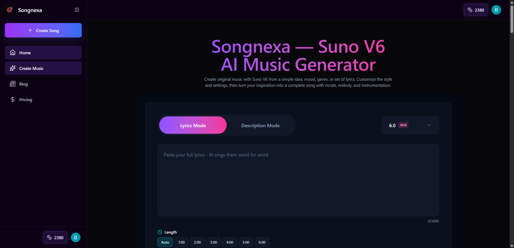
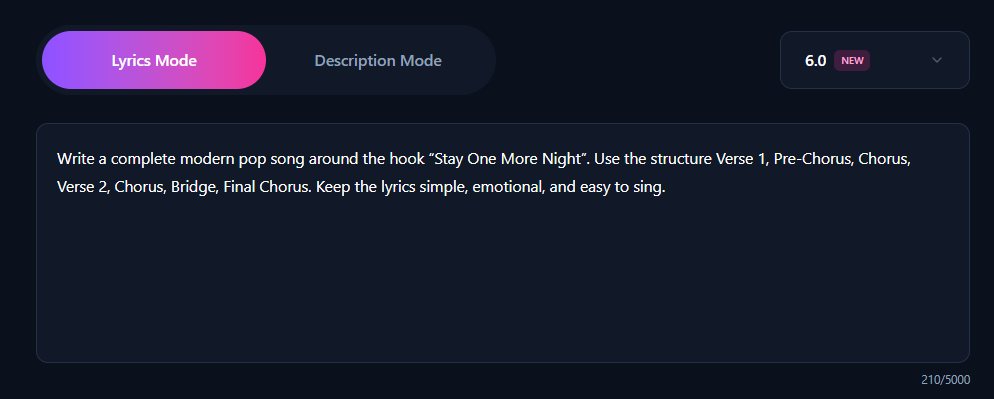
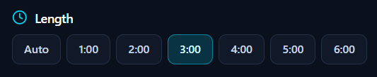
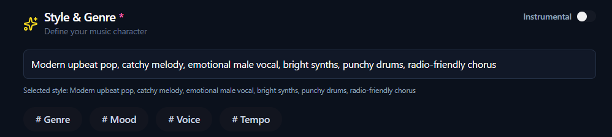
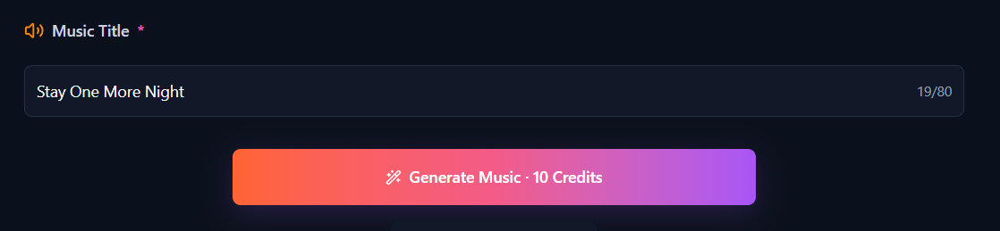
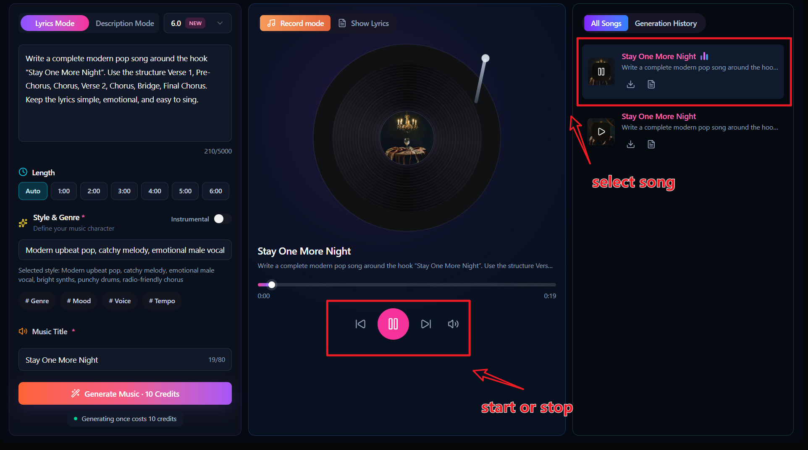

[show all articles](../README.md)

# How to Write a Hit Song: Lyrics, Music Style, & More

Making a song with AI has become easier than ever.

In the past, producing a complete song usually meant writing lyrics, arranging the music, recording vocals, and mixing everything together. For most people, this process had a relatively high barrier to entry.

Today, you only need an idea, a set of lyrics, or even a simple description, and AI can help turn it into a complete song.

The tool used in this guide is Songnexa, and it is very simple to use.

If this is your first time creating a song, just follow the steps below.

## 1. Open Songnexa

The first step is to open Songnexa:

[https://sunov6ai.com](https://sunov6ai.com)

Songnexa is an online AI music generator that runs directly in your browser, so you do not need to install any software.

Once you open the homepage, you will see the song generation section.

The two main modes are:

**Lyrics Mode**

and

**Description Mode**

If you already have lyrics prepared, Lyrics Mode is the better choice.

If you do not have lyrics yet and only have an idea for the song, you can choose Description Mode.

## 2. How to Make a Hit Song: Choose the Right Direction First

You should avoid simply telling the AI:

“Generate a pop song for me.”

A short request like this can still produce a song, but the result will be much more unpredictable.

A better approach is to define several basic elements first.

- Genre: Pop
- Mood: Romantic
- Tempo: Upbeat
- Vocal: Male Vocal
- Key Feature: Catchy Chorus
- Overall Feel: Modern / Radio-friendly

When these elements are combined, the direction of the song becomes much more specific.

For this example, we will create:

> A modern pop song with an upbeat rhythm, a romantic feeling, male vocals, and a catchy chorus that is easy to remember.

This gives the AI much clearer guidance than simply asking it to “generate a pop song.”

## 3. If This Is Your First Song, Start with Description Mode

If you do not have any songwriting experience, starting with Description Mode is a good choice.

With this mode, you do not need to prepare full lyrics beforehand.

You only need to explain:

What kind of song you want.

For example, if we want to make a modern pop song, we can enter:

> Create a modern upbeat pop song about wanting someone to stay for one more night. Use an emotional male vocal, a catchy chorus, bright synths, and punchy drums.

This prompt mainly contains the following details:

- Modern upbeat pop
- The theme is wanting someone you love to stay for one more night
- Male vocal
- Catchy chorus
- Bright synths
- Punchy drums

This gives the AI a much clearer idea of what kind of song to generate.

If you do not want to write such a detailed prompt, you can use a shorter version instead:

> Create a catchy modern pop song about love and missing someone.

This can still generate a song, but you will have less control over the final result.

**At this point, you can simply click Generate. This is the easiest approach, and you do not need to change any other settings.**

## Duration Settings

Set the duration to 2–3 minutes. Otherwise, you may end up with only a short chorus that lasts a few dozen seconds.

If you want more control over the song, keep following the steps below.

## 4. How to Make a Hit Song with a Catchy Hook

If you want people to remember your song, the chorus is especially important, particularly in pop music.

A hook is basically the most memorable line in the song.

The theme of our example song is:

“Wanting someone to stay for one more night.”

So the hook could be:

> Stay one more night

This phrase is short and works well when repeated.

You can even use the same phrase as the title of the song:

**Stay One More Night**

This keeps the song title aligned with the main chorus hook.

If you are not sure how to write a hook yourself, you can also ask AI to create one.

Enter:

> Write 5 short and catchy chorus hooks for a modern pop song about asking someone to stay one more night.

Then pick the one you like the most.

## 5. After You Have a Hook, Prepare the Lyrics

If you want more control over the song, switch to Lyrics Mode.

This mode lets you control:

- The theme of the lyrics
- Verse content
- Chorus
- Bridge
- Number of repetitions
- Hook

A pop song can follow a structure like this:

Verse 1 introduces the story.

The Pre-Chorus starts building emotion.

The Chorus contains the most memorable part of the song.

Verse 2 continues the story.

The Bridge adds a change.

Finally, the song returns to the Final Chorus.

You can first ask AI to create the lyrics around your hook:

> Write a complete modern pop song around the hook “Stay One More Night”. Use the structure Verse 1, Pre-Chorus, Chorus, Verse 2, Chorus, Bridge, Final Chorus. Keep the lyrics simple, emotional, and easy to sing.

After the lyrics are generated, copy them into Songnexa's Lyrics Mode.

## Duration Settings

Set the song length to 2–3 minutes. Otherwise, you may only get a short chorus lasting a few dozen seconds.

## 6. Do Not Enter Only “Pop” for Style & Genre

For **Style & Genre**, it is better to combine several elements that describe the sound you want.

For example:

> Modern upbeat pop, catchy melody, emotional male vocal, bright synths, punchy drums, radio-friendly chorus

If you want the song to feel slower and more emotional, you can use:

> Emotional pop ballad, warm male vocal, piano-driven melody, soft drums, cinematic atmosphere, powerful chorus

If you prefer a rock style, try:

> Modern pop rock, energetic male vocal, electric guitars, strong drums, catchy chorus, emotional bridge

**Genre + Mood + Vocal + Instrument + Chorus characteristics**

## 7. A Hit Song Needs a Memorable Title

A simple method is to choose a line directly from the Chorus or Hook.

For example, our main hook is:

> Stay One More Night

So the song title can simply be:

**Stay One More Night**

This keeps the title, the song theme, and the chorus connected.

Once all the settings are ready, click Generate.

Songnexa will start creating the song.

After a short wait, the full result will appear. On the right side, you can see the newly generated songs along with your earlier generation history.

Click the generated result on the far right to play the song.

## 8. How to Make a Hit Song Without Overcomplicating It

When people see the phrase “How to Make a Hit Song,” they may immediately think they need:

Very complex lyrics.

Very complex arrangements.

A lot of music theory.

But if you are using AI to create a song that is easy to listen to and easy to remember, keeping things simple is often more effective.

Focus on a few key points:

**First, make the theme clear.**

**Second, keep the Hook short.**

**Third, repeat the Chorus.**

**Fourth, make the Style description specific.**

**Fifth, generate multiple versions and compare the results.**

AI music generation will not give you the perfect result every time.

Generating two or three rounds usually gives you a better chance of finding a version you really like.

Whether you are asking “how to make AI songs?”, “how to use AI to make a song?”, or “how to make an AI song in 1 minute?”, this tutorial can help you get started.