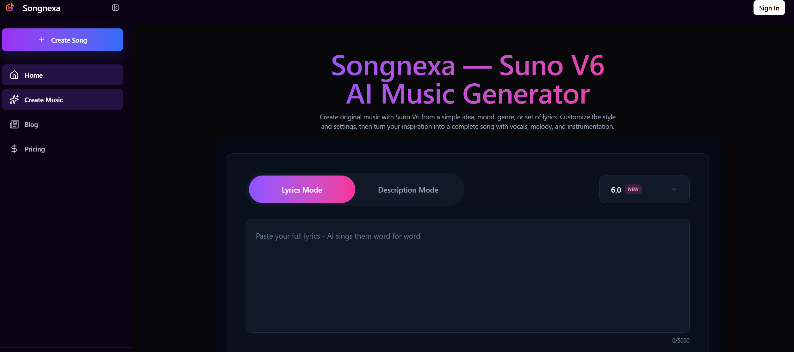
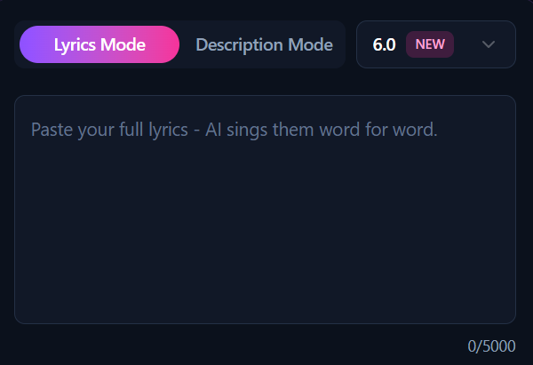
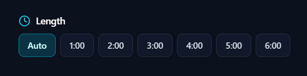
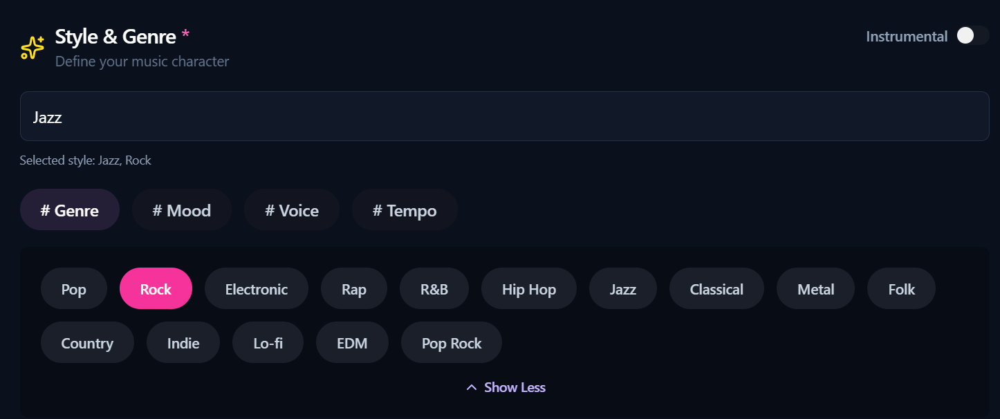
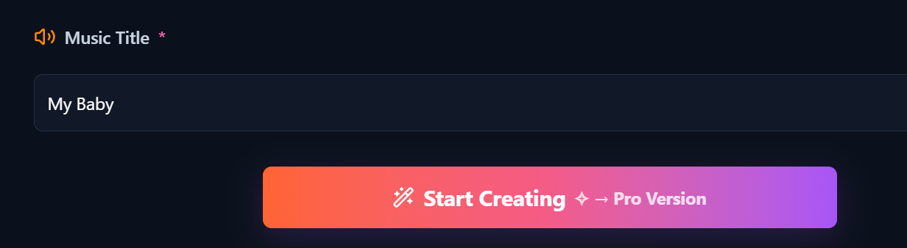
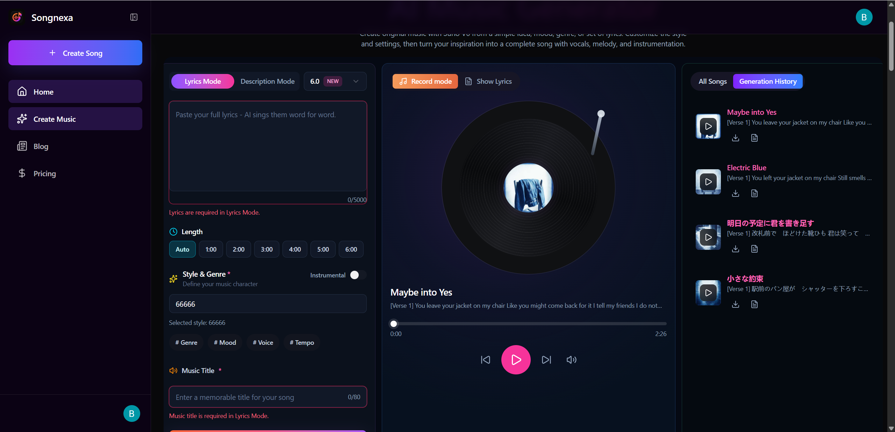
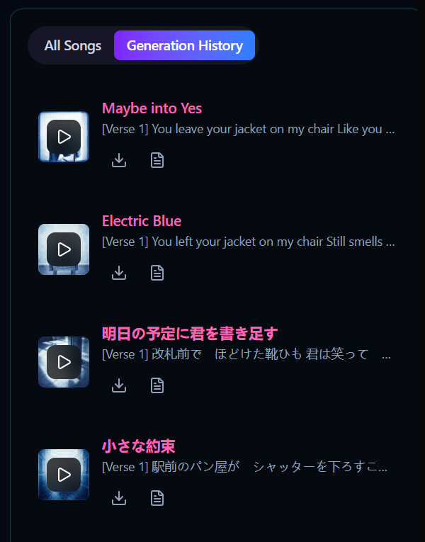
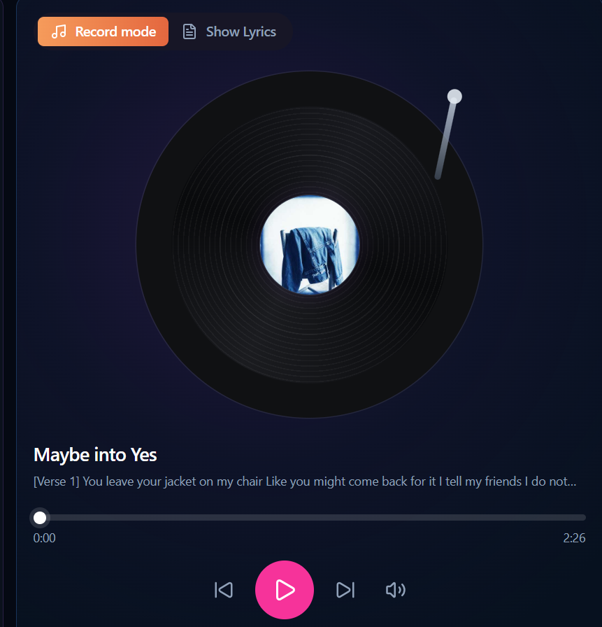

[show all articles](../README.md)

# how to make a song with AI(from start to finish)

If you want to make a song today, using AI is one of the simplest ways to do it.

With the tool and method introduced in this guide, you can create a complete song in just a few minutes.

You can use the finished song as a birthday gift for your girlfriend, background music for YouTube videos, a personalized alarm, or many other creative uses.

## 1. Choose a Tool

The first thing you need to do is pick an AI music generation tool that is easy to use.

The easiest option is usually an online tool that runs directly in your browser.

You do not need to install any software or set up your computer environment, which makes the whole process much simpler.

To get started, open the AI music generation tool: [Songnexa](https://sunov6ai.com/)

Website: [https://sunov6ai.com](https://sunov6ai.com/)

## 2. Choose a Generation Mode

After opening the Songnexa homepage, you will see the music generation interface.

There are two main modes for generation: Lyrics Mode and Description Mode.

**Lyrics Mode:** This mode works well if you want to write your own lyrics or already have lyrics prepared.

For this example, I prepared a full set of lyrics in advance.

The lyrics were created with the help of AI, using Justin Bieber's *Baby* as a reference for the overall direction and style.

I have placed the lyrics at the end of this article, so you can refer to them if you need an example.

Prompt:

Use Justin Bieber's *Baby* as a reference and help me create a complete set of lyrics.

**Description Mode:** If you want a simpler method and do not want to write lyrics yourself, you can just describe the kind of song you want in natural language.

For example:

“Create a song with a similar style and feeling to Justin Bieber's *Baby*.”

## 3. Set the Song Duration

Next, select the duration of your song.

The default setting is **Auto**. If you keep it as it is, the AI will automatically decide a suitable song length.

The available duration options are:

**Auto, 1:00, 2:00, 3:00, 4:00, 5:00, and 6:00**

Just choose the duration that best suits your needs.

## 4. Set the Style & Genre

Next, choose the music style and genre you want to use.

You can type in a style directly, such as rock, pop, ballad, electronic music, or any other genre you prefer.

Songnexa also includes many built-in music styles. You can click the style button to browse the available categories and select the one that best fits the song you want to create.

## 5. Give Your Song a Name

Since you are making your own song, you should give it a title.

Just enter the song name in the corresponding field.

## 6. Click Generate

The last step is very simple: click the **Generate** button.

After that, wait for the AI to create your music.

In a short while, your new song will be ready.

## 7. Switch to Professional Mode

Once the generation begins, Songnexa will automatically switch to Professional Mode.

This is the place where you can view and manage the songs you create.

Songnexa currently creates two versions of a song at one time.

This is one of my favorite features because getting two different results gives you a better chance of finding a song you like without generating again.

In Professional Mode, the right side of the page shows your generated songs and generation history.

Songs created by free users can currently be saved for 15 days, while songs generated by paid members can be stored permanently.

The middle section of the page contains the music player, where you can play and pause your generated songs.

You can also click the lyrics section at the top of the page to open the lyrics view and review the lyrics for the current song.

## 8. Final Thoughts

Songnexa currently provides a free trial.

After signing up, you can generate two songs and try the service before deciding whether it suits your needs.

If you are happy with the results, you can then choose a paid plan based on what you need.

Songnexa also lets creators download all of the songs they generate without any download limit.

Official website: [https://sunov6ai.com](https://sunov6ai.com/)

## FAQ

I recently saw someone on X.com asking:

“how to make a song? i have lyrics but don't know where to start”

If you already have lyrics but do not know how to turn them into a complete song, this is exactly the kind of situation where you can start with a tool like Songnexa.

There are also many similar questions online, such as:

- how to make a song?
- how to make songs?
- how to make your own song?
- how to make a good song?
- how to get song ideas and make songs?

It is clear that many people are wondering how to begin songwriting.

Hopefully, this step-by-step guide can help anyone who wants to turn an idea or a set of lyrics into a complete song.

